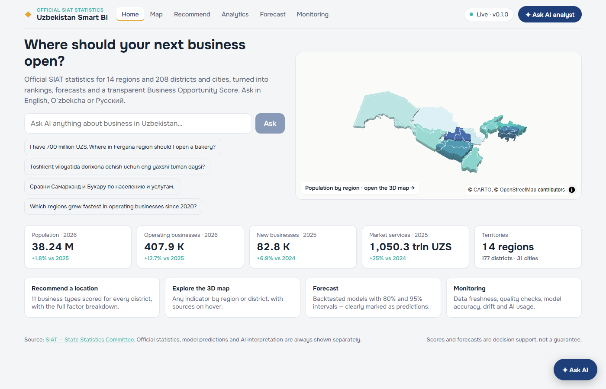
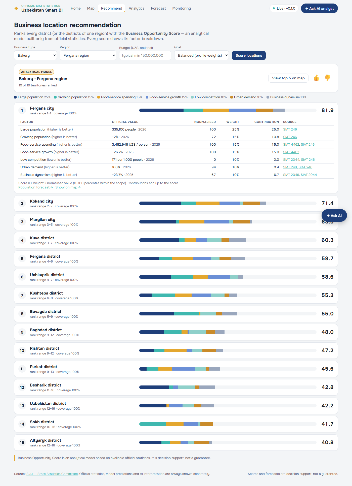
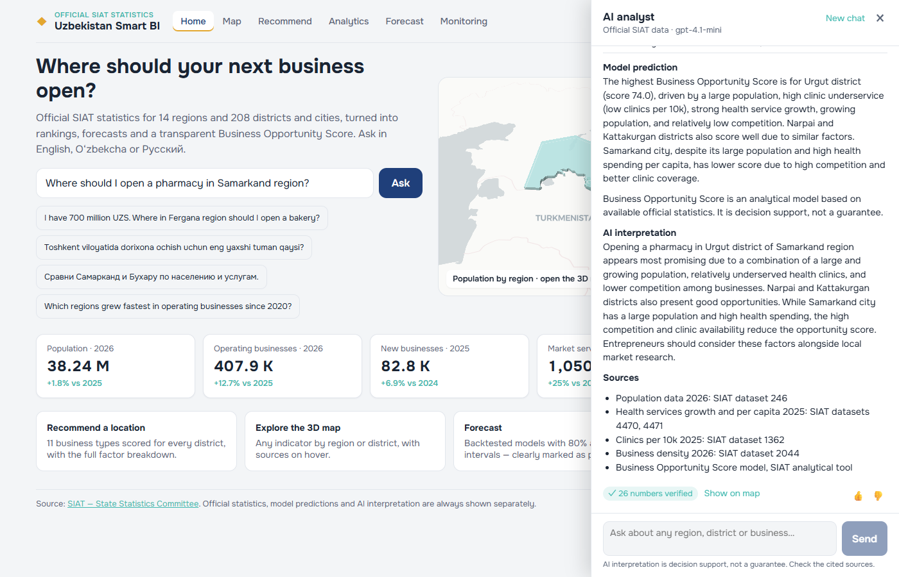
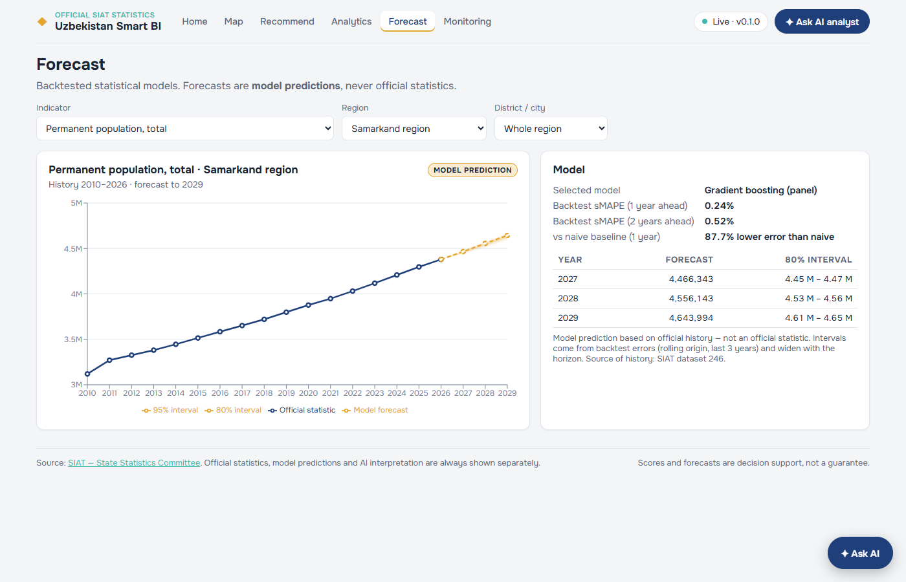

# Uzbekistan Smart Business Intelligence

An agentic AI platform that turns official **SIAT / Stat.uz** statistics into data-backed business location
recommendations for Uzbekistan:

**SIAT download → warehouse → features → forecasts → Business Opportunity Score → MCP tools → AI agent + RAG →
dashboard + 3D map + chat → monitoring + evaluation.**



## What it does

- **3D map** of 14 regions and 208 districts/cities, coloured and extruded by any official indicator.
- **Location recommendations** for 11 business types with a transparent **Business Opportunity Score**: every
  score shows its factor breakdown, official values, years, SIAT sources and a rank range.
- **Forecasts** (1–3 years) from backtested models with 80 % / 95 % intervals, always labelled as predictions.
- **AI analyst** (English, O‘zbekcha, Русский). It calls tools for every number, and a verifier checks each
  number in the answer against the tool results. It works without an OpenAI key in rule-based mode.
- **MCP server** with 16 statistical tools for Claude Desktop or any MCP client.
- **Monitoring and evaluation:** data quality, drift, forecast error, recommendation stability, AI cost and
  faithfulness, plus Prometheus/Grafana, MLflow and an auto-generated evaluation report.

| Recommend | Map focus from the chat | Forecast |
|---|---|---|
|  |  |  |

## Rules the system enforces

1. The LLM never computes numbers. Growth, shares, per-capita values, scores and forecasts are computed in
   Python, and answers are verified number by number.
2. No invented statistics. Missing data → *"I don't have sufficient official data to answer this reliably."*
3. Every value is traceable to a SIAT dataset, period, unit and retrieval time.
4. Official statistic / model prediction / AI interpretation are always shown as separate layers.
5. The Business Opportunity Score is decision support, not a guarantee, and its breakdown is always shown.

## Quick start (Windows, no Docker)

```powershell
git clone https://github.com/jurabekpirnazarov/uzbekistan-smart-bi.git
cd uzbekistan-smart-bi
copy .env.example .env                      # optional: OPENAI_API_KEY=...
python -m venv .venv ; .\.venv\Scripts\Activate.ps1
pip install -e ".\backend[dev,mlflow]" typer "mcp>=1.9,<2"
# put portable PostgreSQL 16 + PostGIS into .tools\pgsql (see docs/runbook.md), then:
python manage.py db-init
python manage.py demo        # ingest → geography + RAG → features → train → monitor → eval
python manage.py dev         # http://localhost:5174
```

With Docker: `docker compose up -d --build` then `docker compose run --rm worker python manage.py demo`
→ http://localhost:8080. Full instructions are in [docs/runbook.md](docs/runbook.md).

| URL | What |
|---|---|
| http://localhost:5174 | App (local dev) · http://localhost:8080 with Docker |
| http://localhost:8000/docs | REST API (OpenAPI) |
| http://localhost:8100/mcp | MCP server (streamable HTTP) |
| http://localhost:5000 | MLflow (forecast training and evaluation runs) |
| http://localhost:3000 · :9090 | Grafana · Prometheus (Docker stack) |

## Automatic data refresh

`python manage.py schedule` checks SIAT **every week** at 03:00 (Windows Task Scheduler; the Docker stack has a
`scheduler` service): new years of existing datasets are loaded, **newly published datasets are mapped
automatically into the same schema** (flagged "auto-added"), and features, forecasts and the search index are
rebuilt only when something changed. Runs are listed on the Monitoring page. See [docs/runbook.md](docs/runbook.md).

## Commands

```powershell
python manage.py dev | demo | refresh | schedule | ingest | seed | features | train | monitor | eval
python manage.py test | lint | backup | restore | db-start | db-stop
cd frontend ; npm run e2e      # Playwright end-to-end tests (needs `python manage.py dev` running)
```

`DATA_MODE=official` (default) uses official statistics only. Anything synthetic would carry a
**"DEMO / SYNTHETIC DATA"** label in the UI and in agent answers. None is loaded.

## Documentation

| | |
|---|---|
| [Architecture](docs/architecture.md) | components, data flow, agent sequence, deployment (Mermaid) |
| [Data dictionary](docs/data_dictionary.md) · [Schema](docs/schema.md) | indicators, units, tables (ER diagram), traceability |
| [Features](docs/features.md) | every feature: formula and business meaning |
| [Scoring](docs/scoring.md) | Business Opportunity Score method and limitations |
| [API](docs/api.md) · [MCP](docs/mcp.md) | endpoints, SSE events, MCP tools and how to connect |
| [Monitoring](docs/monitoring.md) | metrics, drift, dashboards, alerts |
| [Evaluation report](docs/evaluation_report.md) | generated by `python manage.py eval` |
| [Limitations](docs/limitations.md) | read before using the numbers |
| [Research questions](docs/research_questions.md) · [Demo script](docs/demo_script.md) · [Weekly report](docs/weekly_report_template.md) | internship material |

## Repository layout

```
backend/     FastAPI app — app/services is the only place business logic lives
mcp_server/  FastMCP server (16 tools)
ml/          features/, scoring/ (+ profiles/*.yaml), forecasting/, evaluation/
rag/         index build + hybrid retrieval (full-text + embeddings, RRF)
pipelines/   siat_ingest.py (SIAT downloader), load_siat.py, load_reference.py (geography)
monitoring/  drift.py, Prometheus config + alerts, Grafana dashboards
frontend/    React + Vite + TypeScript, MapLibre 3D map, Recharts, Playwright e2e
tests/       unit/, integration/, eval/ (gold sets)
docs/        documentation and screenshots
```

Data: SIAT, State Statistics Committee of the Republic of Uzbekistan. Boundaries: geoBoundaries / OCHA
(CC BY 3.0 IGO) and dirixtt/GeoJSON-Uzbekistan (MIT). See [data/reference/LICENSES.md](data/reference/LICENSES.md).
