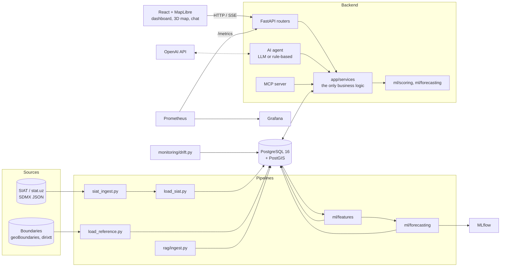
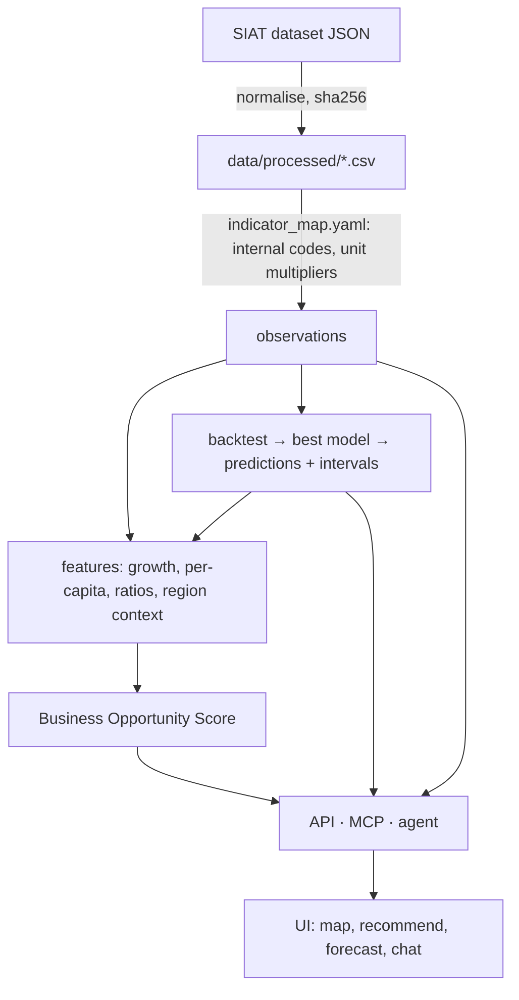
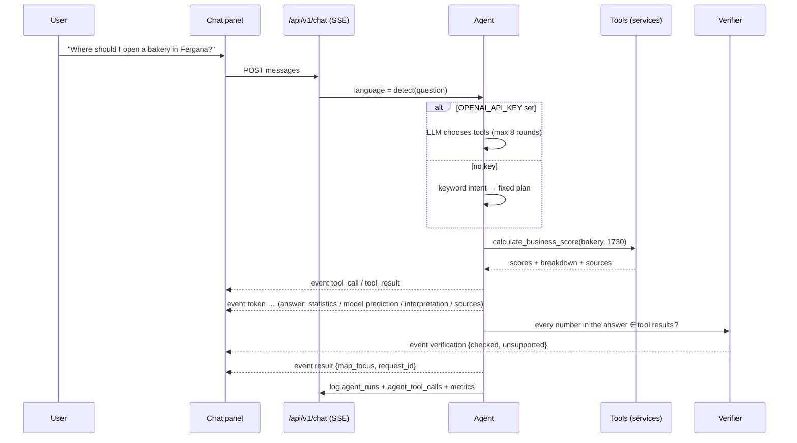
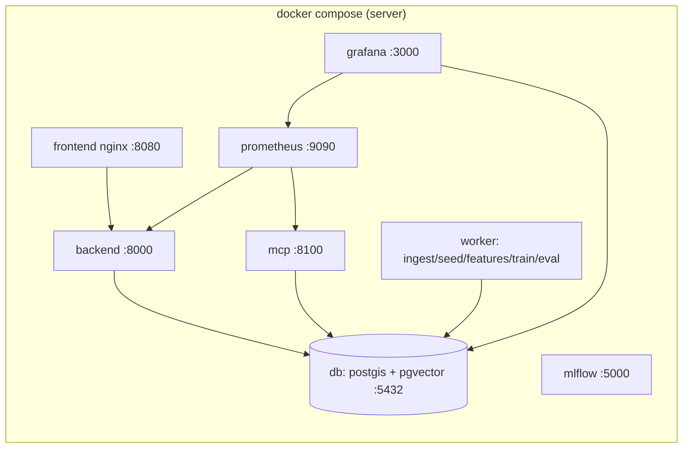

# Architecture

## Components

Routers, MCP tools and agent tools are thin wrappers over `backend/app/services` and `ml/`;
calculation logic is never duplicated.

## Data flow

## Agent sequence

## Deployment

Local development without Docker (`python manage.py dev`) runs the same processes directly: portable
PostgreSQL + PostGIS in `.tools/`, uvicorn on :8000, Vite on :5174, the MCP server on :8100 and the MLflow
UI on :5000. See `docs/runbook.md`.
