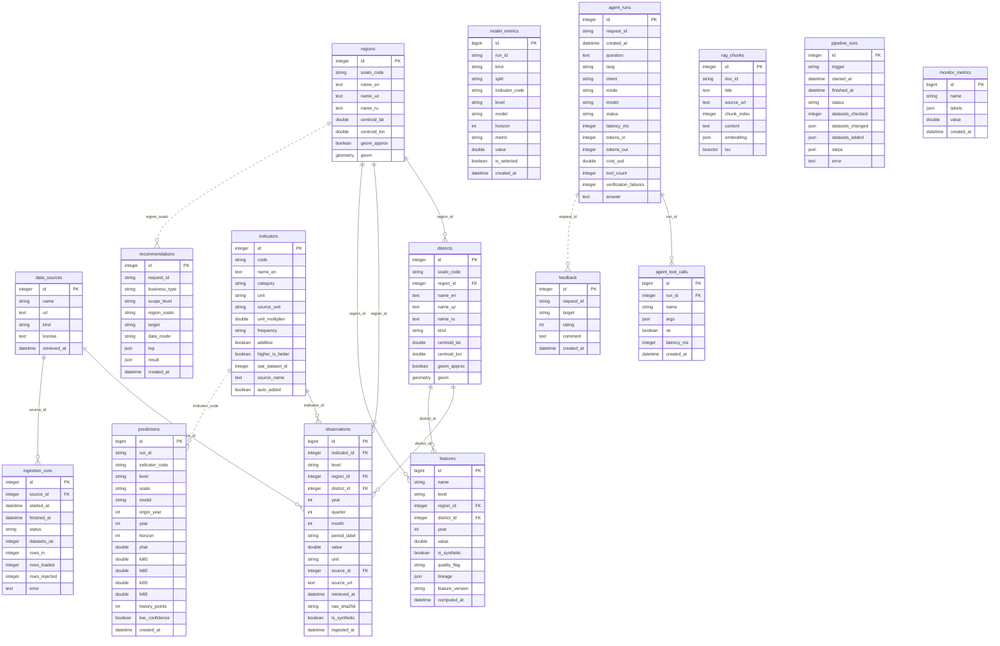

# Database schema

_Generated from `backend/app/db/models.py` by `python -m app.db.schema_doc`. PostgreSQL 16 + PostGIS; migrations in `backend/alembic/versions/` (`python manage.py migrate`)._

Solid lines are foreign keys; dotted lines are logical links by code (SOATO / indicator code / request id).

## Official data (warehouse)

### `data_sources`

| Column | Type | Null | Key / notes |
|---|---|---|---|
| `id` | integer | no | PK |
| `name` | varchar(64) | no |  |
| `url` | text | yes |  |
| `kind` | varchar(16) | no |  |
| `license` | text | yes |  |
| `retrieved_at` | datetime | yes |  |

Constraints: unique (name)

### `regions`

| Column | Type | Null | Key / notes |
|---|---|---|---|
| `id` | integer | no | PK |
| `soato_code` | varchar(16) | no |  |
| `name_en` | text | no |  |
| `name_uz` | text | yes |  |
| `name_ru` | text | yes |  |
| `centroid_lat` | double | yes |  |
| `centroid_lon` | double | yes |  |
| `geom_approx` | boolean | no |  |
| `geom` | geometry(MultiPolygon,4326) | yes | PostGIS boundary (raw SQL) |

Constraints: unique (soato_code)

### `districts`

| Column | Type | Null | Key / notes |
|---|---|---|---|
| `id` | integer | no | PK |
| `soato_code` | varchar(16) | no |  |
| `region_id` | integer | no | FK → regions.id |
| `name_en` | text | no |  |
| `name_uz` | text | yes |  |
| `name_ru` | text | yes |  |
| `kind` | varchar(16) | no |  |
| `centroid_lat` | double | yes |  |
| `centroid_lon` | double | yes |  |
| `geom_approx` | boolean | no |  |
| `geom` | geometry(MultiPolygon,4326) | yes | PostGIS boundary (NULL when approximate) (raw SQL) |

Constraints: unique (soato_code) · index (region_id)

### `indicators`

| Column | Type | Null | Key / notes |
|---|---|---|---|
| `id` | integer | no | PK |
| `code` | varchar(64) | no |  |
| `name_en` | text | no |  |
| `category` | varchar(32) | no |  |
| `unit` | varchar(64) | no |  |
| `source_unit` | varchar(64) | yes |  |
| `unit_multiplier` | double | no |  |
| `frequency` | varchar(16) | no |  |
| `additive` | boolean | no |  |
| `higher_is_better` | boolean | no |  |
| `siat_dataset_id` | integer | yes |  |
| `source_name` | text | yes |  |
| `auto_added` | boolean | no |  |

Constraints: unique (code)

### `observations`

| Column | Type | Null | Key / notes |
|---|---|---|---|
| `id` | bigint | no | PK |
| `indicator_id` | integer | no | FK → indicators.id |
| `level` | varchar(16) | no |  |
| `region_id` | integer | yes | FK → regions.id |
| `district_id` | integer | yes | FK → districts.id |
| `year` | smallint | no |  |
| `quarter` | smallint | yes |  |
| `month` | smallint | yes |  |
| `period_label` | varchar(32) | no |  |
| `value` | double | no |  |
| `unit` | varchar(64) | no |  |
| `source_id` | integer | no | FK → data_sources.id |
| `source_url` | text | yes |  |
| `retrieved_at` | datetime | yes |  |
| `raw_sha256` | varchar(64) | yes |  |
| `is_synthetic` | boolean | no |  |
| `ingested_at` | datetime | no |  |

Constraints: unique (indicator_id, level, region_id, district_id, year, quarter, month, source_id) · index (district_id) · index (indicator_id, level, year) · index (region_id)

### `ingestion_runs`

| Column | Type | Null | Key / notes |
|---|---|---|---|
| `id` | integer | no | PK |
| `source_id` | integer | yes | FK → data_sources.id |
| `started_at` | datetime | no |  |
| `finished_at` | datetime | yes |  |
| `status` | varchar(16) | no |  |
| `datasets_ok` | integer | no |  |
| `rows_in` | integer | no |  |
| `rows_loaded` | integer | no |  |
| `rows_rejected` | integer | no |  |
| `error` | text | yes |  |

## Analytics

### `features`

| Column | Type | Null | Key / notes |
|---|---|---|---|
| `id` | bigint | no | PK |
| `name` | varchar(64) | no |  |
| `level` | varchar(16) | no |  |
| `region_id` | integer | yes | FK → regions.id |
| `district_id` | integer | yes | FK → districts.id |
| `year` | smallint | no |  |
| `value` | double | yes |  |
| `is_synthetic` | boolean | no |  |
| `quality_flag` | varchar(64) | yes |  |
| `lineage` | json | yes |  |
| `feature_version` | varchar(16) | no |  |
| `computed_at` | datetime | no |  |

Constraints: unique (name, level, region_id, district_id, year) · index (name, level, year)

### `recommendations`

| Column | Type | Null | Key / notes |
|---|---|---|---|
| `id` | integer | no | PK |
| `request_id` | varchar(64) | no |  |
| `business_type` | varchar(64) | no |  |
| `scope_level` | varchar(16) | no |  |
| `region_soato` | varchar(16) | yes |  |
| `target` | varchar(32) | yes |  |
| `data_mode` | varchar(16) | no |  |
| `top` | json | yes |  |
| `result` | json | no |  |
| `created_at` | datetime | no |  |

Constraints: index (business_type) · index (request_id)

### `predictions`

| Column | Type | Null | Key / notes |
|---|---|---|---|
| `id` | bigint | no | PK |
| `run_id` | varchar(32) | no |  |
| `indicator_code` | varchar(64) | no |  |
| `level` | varchar(16) | no |  |
| `soato` | varchar(16) | no |  |
| `model` | varchar(32) | no |  |
| `origin_year` | smallint | no |  |
| `year` | smallint | no |  |
| `horizon` | smallint | no |  |
| `yhat` | double | no |  |
| `lo80` | double | yes |  |
| `hi80` | double | yes |  |
| `lo95` | double | yes |  |
| `hi95` | double | yes |  |
| `history_points` | smallint | no |  |
| `low_confidence` | boolean | no |  |
| `created_at` | datetime | no |  |

Constraints: index (indicator_code, level, soato)

### `model_metrics`

| Column | Type | Null | Key / notes |
|---|---|---|---|
| `id` | bigint | no | PK |
| `run_id` | varchar(32) | no |  |
| `kind` | varchar(16) | no |  |
| `split` | varchar(16) | no |  |
| `indicator_code` | varchar(64) | yes |  |
| `level` | varchar(16) | yes |  |
| `model` | varchar(64) | yes |  |
| `horizon` | smallint | yes |  |
| `metric` | varchar(32) | no |  |
| `value` | double | yes |  |
| `is_selected` | boolean | no |  |
| `created_at` | datetime | no |  |

Constraints: index (kind, created_at)

## AI agent and RAG

### `agent_runs`

| Column | Type | Null | Key / notes |
|---|---|---|---|
| `id` | integer | no | PK |
| `request_id` | varchar(64) | no |  |
| `created_at` | datetime | no |  |
| `question` | text | no |  |
| `lang` | varchar(4) | no |  |
| `intent` | varchar(32) | yes |  |
| `mode` | varchar(16) | no |  |
| `model` | varchar(64) | yes |  |
| `status` | varchar(16) | no |  |
| `latency_ms` | integer | no |  |
| `tokens_in` | integer | no |  |
| `tokens_out` | integer | no |  |
| `cost_usd` | double | no |  |
| `tool_count` | integer | no |  |
| `verification_failures` | integer | no |  |
| `answer` | text | yes |  |

Constraints: index (request_id) · index (created_at)

### `agent_tool_calls`

| Column | Type | Null | Key / notes |
|---|---|---|---|
| `id` | bigint | no | PK |
| `run_id` | integer | no | FK → agent_runs.id |
| `name` | varchar(64) | no |  |
| `args` | json | yes |  |
| `ok` | boolean | no |  |
| `latency_ms` | integer | no |  |
| `created_at` | datetime | no |  |

Constraints: index (run_id)

### `feedback`

| Column | Type | Null | Key / notes |
|---|---|---|---|
| `id` | integer | no | PK |
| `request_id` | varchar(64) | yes |  |
| `target` | varchar(16) | no |  |
| `rating` | smallint | no |  |
| `comment` | text | yes |  |
| `created_at` | datetime | no |  |

Constraints: index (request_id)

### `rag_chunks`

| Column | Type | Null | Key / notes |
|---|---|---|---|
| `id` | integer | no | PK |
| `doc_id` | varchar(128) | no |  |
| `title` | text | no |  |
| `source_url` | text | yes |  |
| `chunk_index` | integer | no |  |
| `content` | text | no |  |
| `embedding` | json | yes |  |
| `tsv` | tsvector | yes | generated full-text vector (BM25-style search) (raw SQL) |

Constraints: index (doc_id)

## Operations

### `pipeline_runs`

| Column | Type | Null | Key / notes |
|---|---|---|---|
| `id` | integer | no | PK |
| `trigger` | varchar(16) | no |  |
| `started_at` | datetime | no |  |
| `finished_at` | datetime | yes |  |
| `status` | varchar(16) | no |  |
| `datasets_checked` | integer | no |  |
| `datasets_changed` | json | yes |  |
| `datasets_added` | json | yes |  |
| `steps` | json | yes |  |
| `error` | text | yes |  |

Constraints: index (started_at)

### `monitor_metrics`

| Column | Type | Null | Key / notes |
|---|---|---|---|
| `id` | bigint | no | PK |
| `name` | varchar(64) | no |  |
| `labels` | json | no |  |
| `value` | double | yes |  |
| `created_at` | datetime | no |  |

Constraints: index (name, created_at)
